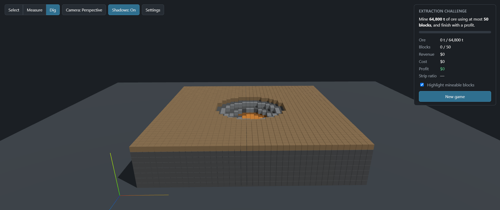
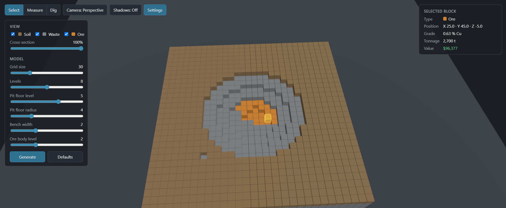
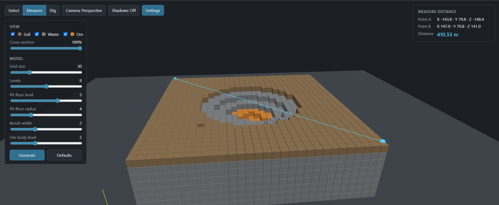
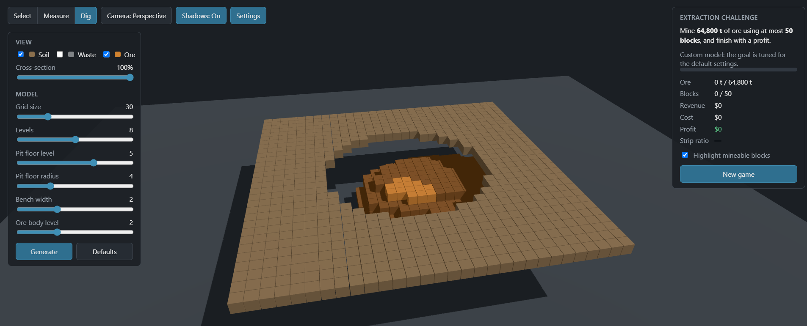
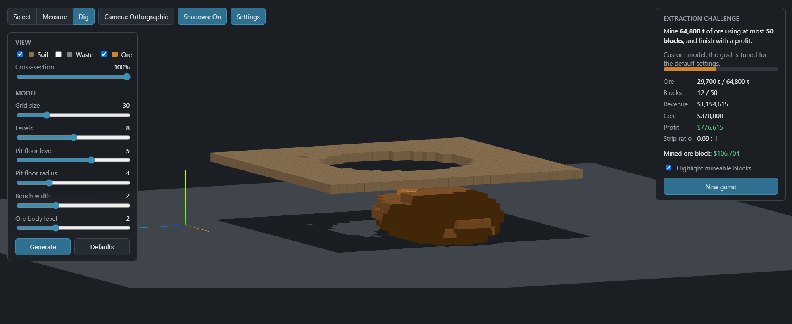

# Pit Viewer

An interactive 3D viewer for an open-pit mine block model, built with **three.js**, **React** and **TypeScript**.

Inspect blocks, measure distances, slice through the model, and play a short mining challenge that uses the same precedence rule real pit-optimisation tools rely on.

**Live demo:** [https://YOUR-PROJECT.vercel.app](https://pitviewer.vercel.app/)



## Features

- **Benched pit made of ~10,000 blocks**, drawn with one `InstancedMesh` per block type (3 draw calls for the whole terrain).
- **Perspective and orthographic cameras** with orbit controls. Switching keeps the same framing.
- **Lighting and shadows**: ambient and directional light with a shadow map that can be turned off.
- **Block selection** with raycasting: shows the type, position, grade, tonnage and economic value of the clicked block.
- **Distance measurement** between two points on the terrain, with markers and a connecting line.
- **Extraction challenge**: mine blocks to reach an ore target within a block budget and stay profitable. A block can only be mined once the 3 × 3 blocks above it are gone (a 45° slope).
- **Settings panel**: hide block types to reveal the ore body, cut a live cross-section with a clipping plane, and regenerate the model with different pit and ore-body parameters.

| Select a block | Measure a distance |
| --- | --- |
|  |  |

| Ore body with waste hidden | Orthographic camera mid-game |
| --- | --- |
|  |  |

## Tech stack

- [three.js](https://threejs.org/) used directly (no react-three-fiber), with `OrbitControls`
- [React](https://react.dev/) and [TypeScript](https://www.typescriptlang.org/)
- [Vite](https://vite.dev/) for development and builds
- [Vitest](https://vitest.dev/) for unit tests and [Playwright](https://playwright.dev/) for end-to-end tests
- Deployed on [Vercel](https://vercel.com/)

## Getting started

Requires Node.js 22.12 or later.

```bash
npm install
npm run dev
```

Then open http://localhost:5173.

| Command | What it does |
| --- | --- |
| `npm run dev` | Starts the development server |
| `npm run build` | Type-checks and builds for production into `dist/` |
| `npm run preview` | Serves the production build locally |
| `npm test` | Runs the unit tests once |
| `npm run test:watch` | Runs the unit tests in watch mode |
| `npm run test:e2e` | Builds the app and runs the Playwright test |
| `npm run lint` | Lints the code with Oxlint |

Before the first end-to-end run, install the browser once with `npx playwright install chromium`.

## How it works

### React and three.js

React owns the UI state (current mode, camera, settings, game progress). three.js lives in a plain TypeScript module, [`createViewer`](src/viewer/createViewer.ts), which returns a small imperative API (`setCameraMode`, `loadModel`, `resetGame`, …).

The [`Viewer`](src/viewer/Viewer.tsx) component connects the two:

- creates the viewer once in `useEffect` and disposes every GPU resource on unmount;
- forwards each prop change to the matching viewer method, so the scene is never rebuilt on a re-render;
- keeps callbacks in a ref so the viewer always calls the latest version.

### Instancing and picking

Each block type is a single `InstancedMesh`. A raycast against it returns an `instanceId`, which maps back to the block's data. Removing a mined block swaps it with the last instance and decreases `mesh.count`, an O(1) update with no buffer reallocation.

### Mining rules

- **Value of a block:** tonnage × grade × recovery × metal price, minus mining and processing costs. See [`economy.ts`](src/game/economy.ts).
- **Precedence:** a block is mineable only when the 3 × 3 blocks on the level above are gone. Checking one level is enough: those blocks had to satisfy the same rule, so the full 45° cone follows by induction. See [`precedence.ts`](src/game/precedence.ts).
- **Strip ratio:** waste tonnes per ore tonne, the standard measure of how much rock is moved for each tonne of ore.

### Cross-section

A `THREE.Plane` is passed to the block materials as a clipping plane, and moving the slider only updates the plane's constant. The cut snaps to block boundaries so blocks are either whole or hidden, and `clipShadows` keeps the hidden part from casting shadows. Picking skips clipped and hidden blocks, so you can only click what you can see.

## Project structure

```
src/
  camera/       Perspective and orthographic camera rig
  game/         Pure game logic: economy, precedence, excavation, summary, goal
  measurement/  Distance function, markers and surface picking
  scene/        Block model, instanced terrain, ground, lights
  selection/    Block picking and highlight
  ui/           React panels and toolbar
  viewer/       three.js setup and the React wrapper
e2e/            Playwright tests
```

The game logic and the block model have no dependency on rendering, so they are covered by fast unit tests.

## Testing

- **Unit tests (Vitest):** distance, block model generation and config validation, economy, precedence, excavation, mining summary and win/loss rules.
- **End-to-end test (Playwright):** opens the app, clicks a block and checks that the panel shows its type and position. The test runs Chromium with SwiftShader so WebGL works without a GPU.

## Assumptions

- 1 scene unit = 1 metre; blocks are 10 m cubes with a density of 2.7 t/m³.
- The ore body is a synthetic ellipsoid with grades from 0.3 % to 2 % Cu, and prices and costs are illustrative.
